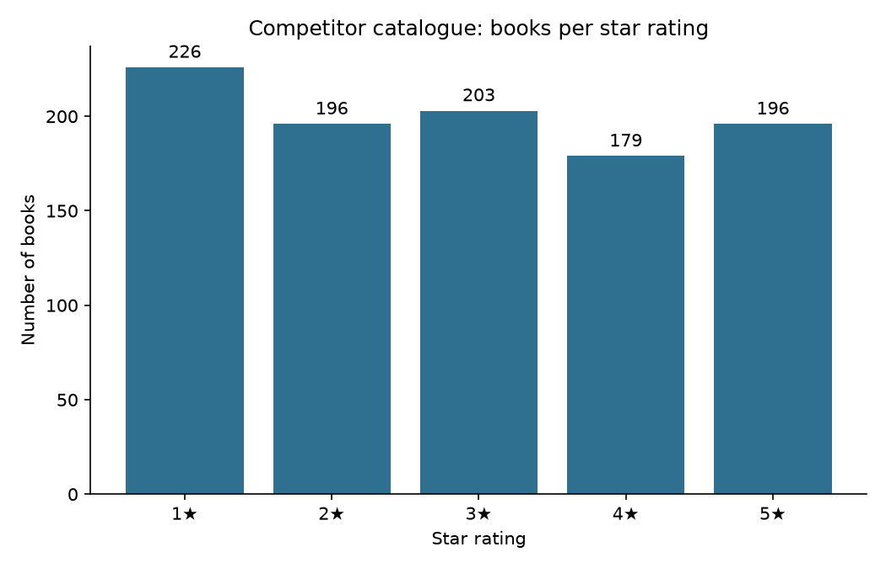

# Bookstore Intelligence: Competitor Web Scraper

A Python scraper that turns the competitor catalogue at [books.toscrape.com](https://books.toscrape.com/) into a clean business dataset, then uses it to answer pricing and range questions and solve a £100 purchasing challenge.

*Business Data and Text Mining, Assignment 2: The Bookstore Intelligence Mission*

**Result:** 1,000 books from all 50 catalogue pages, saved to `competitor_books.csv` by the scraper.

---

## How it works

1. **Download a page.** `requests` fetches the catalogue page through a session. The encoding is forced to UTF-8 so the `£` sign doesn't turn into `£`.
2. **Find every product card.** BeautifulSoup collects all 20 `<article class="product_pod">` cards on the page.
3. **Extract four fields from each card.** Title, price, rating and availability, plus the product URL (see the reconnaissance table below).
4. **Convert the rating.** The site stores the rating as a word in a CSS class (`star-rating Three`). A dictionary maps `One`–`Five` to `1`–`5`.
5. **Follow the "next" button.** One `while` loop reads the `li.next > a` link and keeps going until it's missing on the last page. The same function scrapes every page, so no scraping code is copied and pasted.
6. **Clean and save.** The records go into a Pandas DataFrame. The script strips whitespace, sets the data types, removes duplicate URLs and checks that ratings are 1–5, prices are positive and nothing is missing. It then writes `competitor_books.csv`.
7. **Analyse.** The script prints the answers to the seven questions, the rating counts and the evidence for the recommendation. It solves the £100 challenge exactly and saves a bar chart.

## Run it

```bash
pip install -r requirements.txt
python bookstore_scraper.py              # Boss level: all catalogue pages
python bookstore_scraper.py --pages 3    # minimum requirement
python bookstore_scraper.py --pages 5    # Bonus 1
```

On Windows you can also double-click `run_scraper.bat`, which installs the libraries, runs the scraper and writes the output to `run_log.txt`.

---

## Mission 1: Reconnaissance

Each book on a catalogue page sits inside `<article class="product_pod">`.

| Data needed | HTML tag / class found | Notes |
|---|---|---|
| Book title | `<h3><a href="..." title="...">` | The visible link text is cut short (`A Light in the ...`), so the scraper reads the **`title` attribute** for the full name. The `href` is the relative product URL. |
| Price | `<p class="price_color">` | Text such as `£51.77`. Strip the `£` and convert to a float. |
| Rating | `<p class="star-rating Three">` | The rating isn't text. It's the **second CSS class word**, so map `One`–`Five` → `1`–`5`. All five star icons are always in the HTML; CSS colours them. |
| Availability | `<p class="instock availability">` | `In stock` surrounded by whitespace and an icon. Use `get_text(strip=True)`. |
| Next page | `<li class="next"><a href="page-2.html">` | Missing on page 50 of 50, which is how the loop knows to stop. |

## Dataset: `competitor_books.csv`

| Column | Example | Description |
|---|---|---|
| Title | A Light in the Attic | Full book title |
| Price | 51.77 | Price in £ (float) |
| Rating | 3 | Star rating, 1–5 (integer) |
| Availability | In stock | Stock status from the listing |
| Product_URL | https://books.toscrape.com/catalogue/a-light-in-the-attic_1000/index.html | Bonus 2 |
| Page | 1 | Catalogue page the book was scraped from |

1,000 rows, no missing values, no duplicate products. One title, *The Star-Touched Queen*, appears twice with different product IDs and prices (£46.02 and £32.30). Both rows are kept because they're separate listings.

---

## Mission 4: Intelligence Analysis (all 1,000 books)

| # | Question | Answer |
|---|---|---|
| 1 | Most expensive book | **The Perfect Play (Play by Play #1)**: £59.99 (3★) |
| 2 | Cheapest book | **An Abundance of Katherines**: £10.00 (5★) |
| 3 | Average book price | **£35.07** (median £35.98) |
| 4 | Books with a 5-star rating | **196** of 1,000 (19.6%) |
| 5 | % of books in stock | **100%** (all 1,000 listings show "In stock") |
| 6 | Top 5 highest-rated books | See below |
| 7 | Cheapest 5-star book | **An Abundance of Katherines**: £10.00 |

**Top 5 highest-rated.** 196 books tie at 5 stars, so a tie-breaker is needed. These are the five cheapest 5-star books, i.e. the best value at the top rating:

| Rank | Title | Rating | Price |
|---|---|---|---|
| 1 | An Abundance of Katherines | 5★ | £10.00 |
| 2 | Greek Mythic History | 5★ | £10.23 |
| 3 | The Power Greens Cookbook: 140 Delicious Superfood Recipes | 5★ | £11.05 |
| 4 | Dear Mr. Knightley | 5★ | £11.21 |
| 5 | The Darkest Corners | 5★ | £11.33 |

---

## Business recommendation

> I would prioritise the competitor's 5-star titles, starting with the 42 that cost under £20 (such as *An Abundance of Katherines* at £10.00 and *Greek Mythic History* at £10.23), and launch them as a "top-rated under £20" range, while leaving out most of the 1-star tail. The competitor doesn't charge more for quality: price and rating are almost unrelated (correlation 0.03), and its average 5-star book costs £35.37 against £34.56 for a 1-star book, so a store that curates by rating can offer clearly better value at the same prices. 1-star books are the competitor's largest group (226 of 1,000, 22.6%), and every title is in stock, so we should compete on curation and value rather than on range or availability.

**Evidence:**

| Rating | Books | Average price | Median price |
|---|---|---|---|
| 1★ | 226 | £34.56 | £34.77 |
| 2★ | 196 | £34.81 | £36.22 |
| 3★ | 203 | £34.69 | £33.78 |
| 4★ | 179 | £36.09 | £37.80 |
| 5★ | 196 | £35.37 | £36.90 |

- Correlation between price and rating: **0.028** (effectively none)
- 5-star books under £20: **42**
- In stock: **100%**

---

## Final challenge: The CEO has £100

**Goal:** maximise the total star rating without spending more than £100.

**Method:** this is a 0/1 knapsack problem (each book can be bought at most once). Prices are converted to pence and solved exactly with dynamic programming over all 1,000 books. When several selections reach the same top score, the script picks the cheapest.

| # | Title | Price | Rating |
|---|---|---|---|
| 1 | An Abundance of Katherines | £10.00 | 5 |
| 2 | Greek Mythic History | £10.23 | 5 |
| 3 | The Power Greens Cookbook: 140 Delicious Superfood Recipes | £11.05 | 5 |
| 4 | Dear Mr. Knightley | £11.21 | 5 |
| 5 | The Darkest Corners | £11.33 | 5 |
| 6 | Naturally Lean: 125 Nourishing Gluten-Free, Plant-Based Recipes--All Under 300 Calories | £11.38 | 5 |
| 7 | Fruits Basket, Vol. 2 (Fruits Basket #2) | £11.64 | 5 |
| 8 | Old School (Diary of a Wimpy Kid #10) | £11.83 | 5 |
| 9 | The Origin of Species | £10.01 | 4 |
| | **Total** | **£98.68** | **44** |

**Why 44 is the maximum.** The 10 cheapest books in the whole catalogue cost £102.35 together, so no selection can contain more than 9 books. Nine books could score 45 only if all nine were 5-star, but the 9 cheapest 5-star books cost £100.56, which is over budget. So 45 is impossible, and 44 (eight 5-star books plus the cheapest 4-star book) is the best possible score. £1.32 is left over.

---

## Bonus missions

- [x] **Bonus 1:** 5 pages: `--pages 5`
- [x] **Bonus 2:** Product page URL added (`Product_URL` column)
- [x] **Bonus 3:** Books per star level: 1★ 226 · 2★ 196 · 3★ 203 · 4★ 179 · 5★ 196
- [x] **Bonus 4:** Bar chart of rating counts (`rating_counts.png`)
- [x] **Boss level:** All 50 pages, using the same loop (the default run)



## Same code, different scope

The answers depend on how many pages are scraped, which is why teams' results differ. The same script with `--pages 3` or `--pages 5` gives:

| | 3 pages (60 books) | 5 pages (100 books) | All 50 pages (1,000 books) |
|---|---|---|---|
| Most expensive | Slow States of Collapse: Poems, £57.31 | The Death of Humanity: and the Case for Life, £58.11 | The Perfect Play (Play by Play #1), £59.99 |
| Cheapest | In Her Wake, £12.84 | Patience, £10.16 | An Abundance of Katherines, £10.00 |
| Average price | £35.00 | £34.56 | £35.07 |
| 5-star books | 14 | 19 | 196 |
| Cheapest 5-star | Sophie's World, £15.94 | Princess Between Worlds, £13.34 | An Abundance of Katherines, £10.00 |
| £100 challenge | 6 books, £96.59, score 26 | 7 books, £98.61, score 31 | 9 books, £98.68, score 44 |

More pages means more cheap, highly rated books to choose from, so the £100 budget goes further.

## Files

| File | Purpose |
|---|---|
| `bookstore_scraper.py` | Scraper, cleaning, analysis, £100 solver and chart |
| `competitor_books.csv` | Dataset produced by the scraper (1,000 rows) |
| `rating_counts.png` | Bonus 4 bar chart |
| `requirements.txt` | `requests`, `beautifulsoup4`, `pandas`, `matplotlib` |
| `run_scraper.bat` | One-click run on Windows |

*books.toscrape.com is a sandbox built for scraping practice. The scraper waits 0.5 seconds between pages to keep the load on the server light.*
